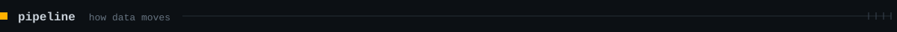
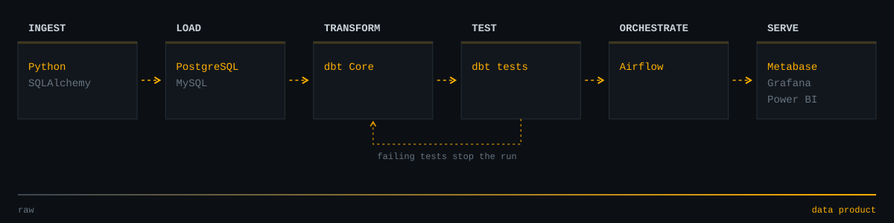
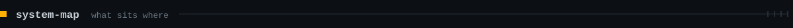
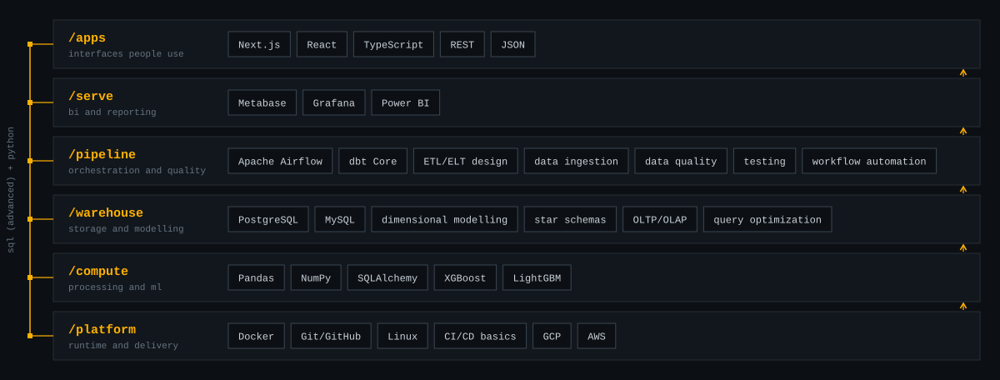
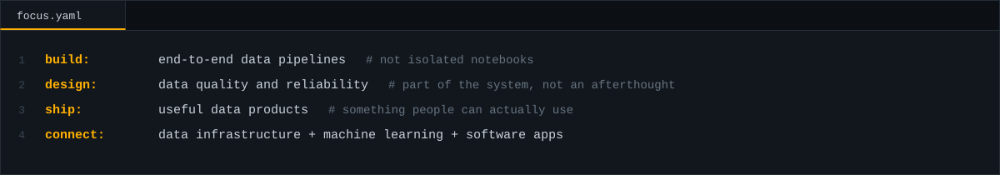
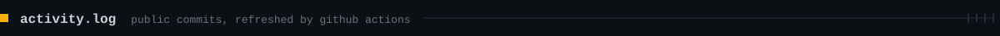
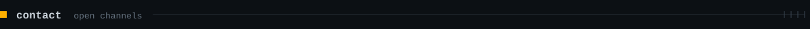
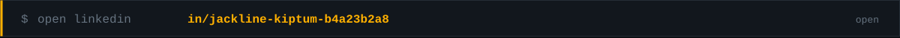

<div align="center">














</div>

<!--ACTIVITY:START-->
```text
$ git log --all --oneline -n 5
waiting for the first workflow run
```
<!--ACTIVITY:END-->

<div align="center">


<a href="mailto:kiptumjackline77@gmail.com"></a>
<a href="https://www.linkedin.com/in/jackline-kiptum-b4a23b2a8/"></a>

</div>
